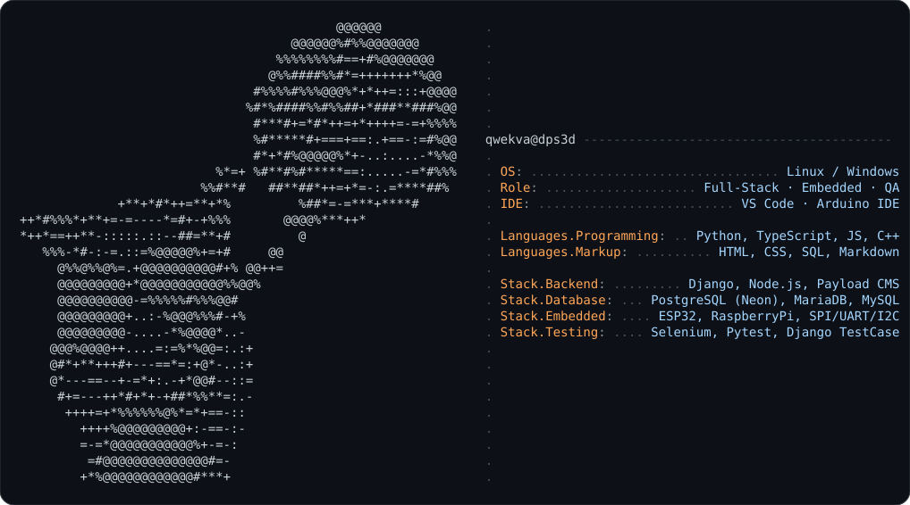

<div align="center">
  
</div>

<br/>

<div align="center">
  
</div>


<br/>

```ts
const stack = {
  languages: ["Python", "TypeScript", "JavaScript", "C++"],
  backend:   ["Django", "Node.js", "Payload CMS", "REST"],
  frontend:  ["Vite", "HTML", "CSS"],
  databases: ["PostgreSQL (Neon)", "MariaDB", "MySQL"],
  embedded:  ["ESP32", "RaspberryPi", "SPI / UART / I2C"],
  testing:   ["Selenium", "Pytest", "Django TestCase"],
  tools:     ["Git", "Linux", "Windows"],
} as const;
```

<br/>

<div align="center">
  
</div>
